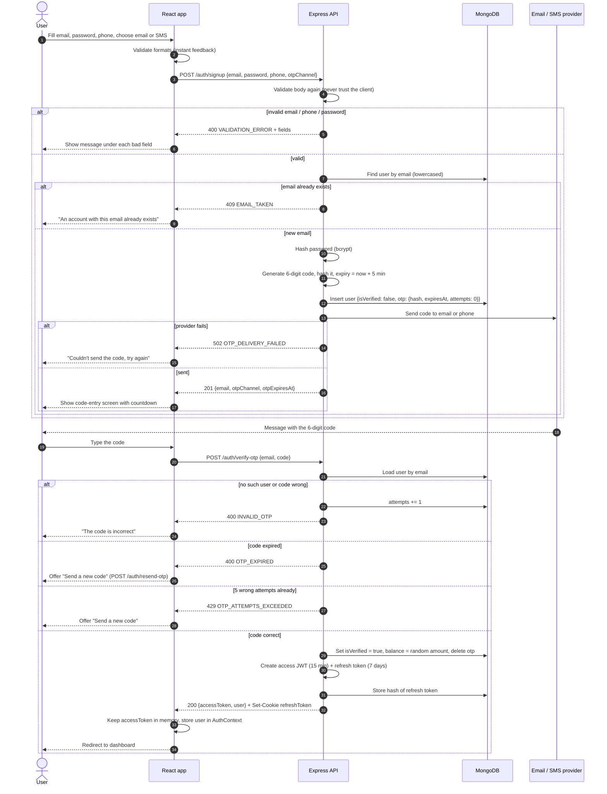
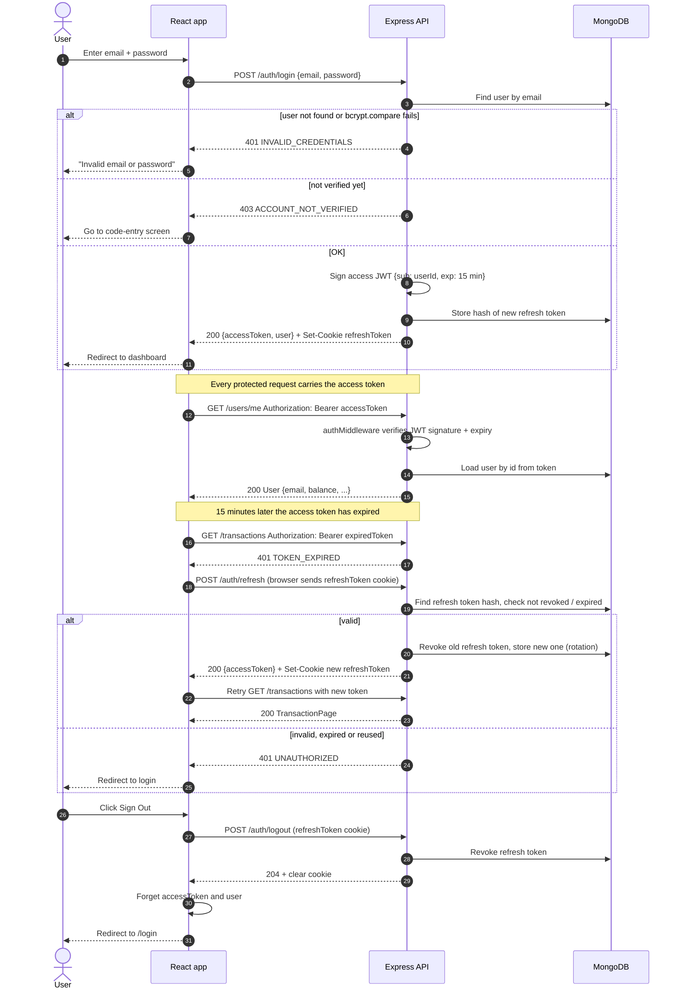
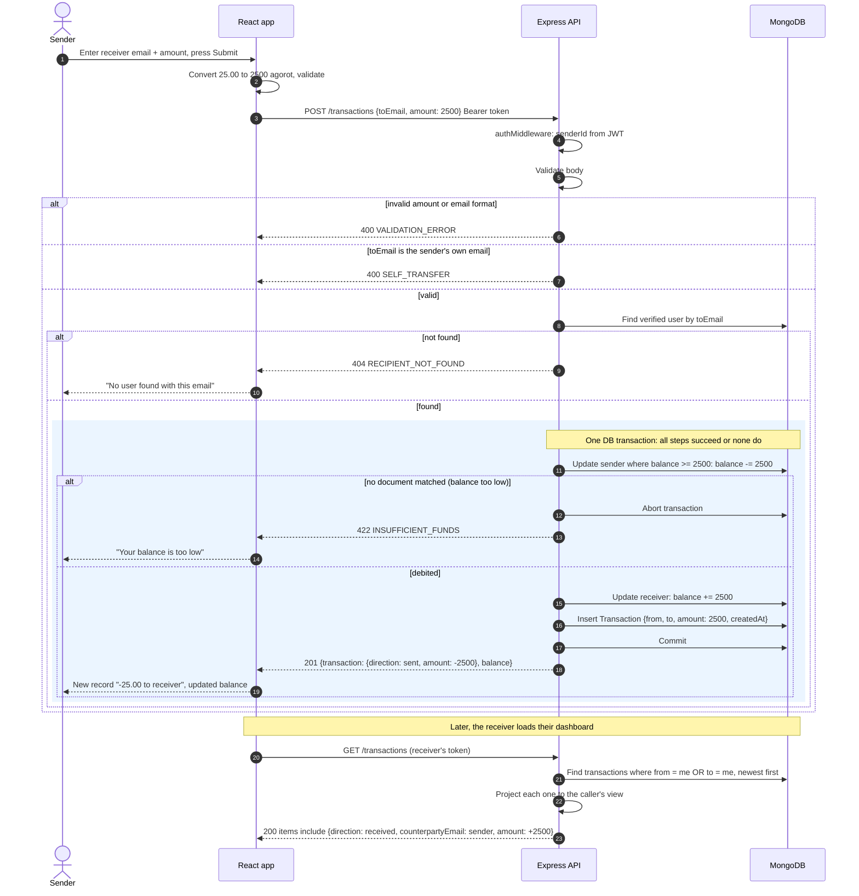

# Sequence diagrams (Phase 1)

These diagrams show **who talks to whom, in what order**, for the app's core
flows. They complement `server/src/docs/openapi.yaml`: the spec says *what*
each endpoint accepts and returns; the diagrams say *how* the endpoints are
used together, and what the server does inside each one.

They render on GitLab, in VS Code (Markdown Preview Mermaid Support
extension), and at <https://mermaid.live>.

## How to read Mermaid sequence diagrams

| Syntax | Meaning |
|---|---|
| `participant A as Name` | A vertical lifeline: one actor or system |
| `A->>B: text` | A sends a request/message to B (solid arrow) |
| `B-->>A: text` | B replies to A (dashed arrow) |
| `A->>A: text` | A does some work internally |
| `alt ... else ... end` | Alternatives: exactly one branch happens |
| `opt ... end` | Optional: happens only if the condition holds |
| `Note over A,B: text` | A comment spanning lifelines |
| `rect rgb(...)` | Shaded box grouping steps (used here for DB transactions) |

Participants used below:

- **User**: the person at the keyboard
- **FE**: the React app in the browser
- **API**: the Express server
- **DB**: MongoDB (in Phase 2 it's an in-memory store, but the steps are the same)
- **OTP**: the email (Nodemailer) or SMS (Twilio) provider

---

## 1. Sign-up + OTP verification (requirements 1, 2, 3b)

**What to notice and why it matters**

- **Validation happens twice (steps 2 and 4).** The frontend check is only for
  a fast, friendly UI. Anyone can bypass it with Postman or curl, so the
  server must validate everything again.
- **The user is inserted *before* the code is checked**, as a pending user
  (`isVerified: false`). The server needs somewhere to keep the code hash
  while waiting, and the user record is the natural place. Login refuses
  pending users with 403.
- **Passwords and OTP codes are stored only as hashes.** If the database
  leaks, the attacker gets hashes, not passwords or valid codes.
- **The code is sent *after* the DB insert.** If we sent first and the insert
  then failed, the user would get a code for an account that doesn't exist.
- **Wrong attempts are counted** and capped at 5. A 6-digit code has only
  1,000,000 values, so without a cap a script could try them all.
- **"No such user" and "wrong code" return the same 400.** The verify screen
  doesn't need to tell an attacker which emails have pending accounts.
- **The random balance is assigned at verification**, not sign-up: an account
  that never finishes sign-up shouldn't hold money.
- **Verification logs the user in** (same response as login), because
  requirement 2b says the user goes straight to the dashboard.

---

## 2. Login, token refresh and logout (requirements 3a, 3d, 4)

**What to notice and why it matters**

- **Same 401 message for "no user" and "wrong password"**, so the login
  form can't be used to find out which emails are registered.
- **Why two tokens?** A JWT can't be cancelled once issued; it's valid until
  it expires. So the access token is kept short (15 min) to limit the damage
  if it's stolen. The refresh token lives longer, but it is stored on the
  server (as a hash), so logout or theft detection can revoke it.
- **Why a cookie for the refresh token?** It's `httpOnly`, so JavaScript
  (including injected XSS code) can't read it. The access token stays in
  memory, never in `localStorage`.
- **The protected request needs no session lookup.** `authMiddleware` only
  checks the JWT signature and expiry. That's the main point of JWT: the
  token proves who you are, so the server stays stateless.
- **Rotation:** every refresh replaces the refresh token. If an attacker
  reuses an old one, the server sees a revoked token and refuses it.
- **Logout uses the cookie, not the access token**, so it still works after
  the access token has expired.

---

## 3. Money transfer (requirement 5)

**What to notice and why it matters**

- **The sender's id comes from the JWT**, never from the request body.
  Otherwise anyone could send money *from* someone else's account.
- **Cheap checks first:** validation, self-transfer, then the recipient
  lookup, all before the transaction starts. Failing early keeps the DB
  transaction short.
- **The balance check is *inside* the debit** (`update ... where balance >=
  amount`), not a separate read-then-write. With a separate read, two
  transfers sent at the same moment could both see "enough money" and both
  succeed, overdrawing the account. A conditional update is atomic: only one
  of them can match.
- **Debit, credit and the record are one DB transaction.** If the server
  crashes after the debit but before the credit, Mongo rolls the debit back,
  so money can't disappear or be created. (MongoDB transactions need a
  replica set. Atlas has one; locally, run Mongo with `--replSet`.)
- **One stored document, two views.** The DB holds one Transaction
  `{from, to, amount}`. The API shows it as `-2500` with the receiver's email
  to the sender, and `+2500` with the sender's email to the receiver
  (requirement 5c). Storing two copies could let them disagree.
- **Amounts are integers in agorot** from the frontend onward, so no
  floating-point rounding can ever create or lose money.
- **The response includes the new balance**, so the dashboard updates
  without a second request.
